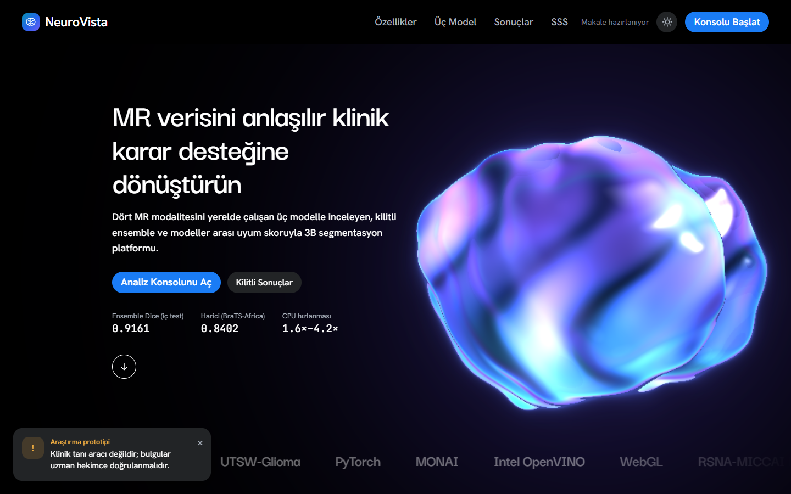
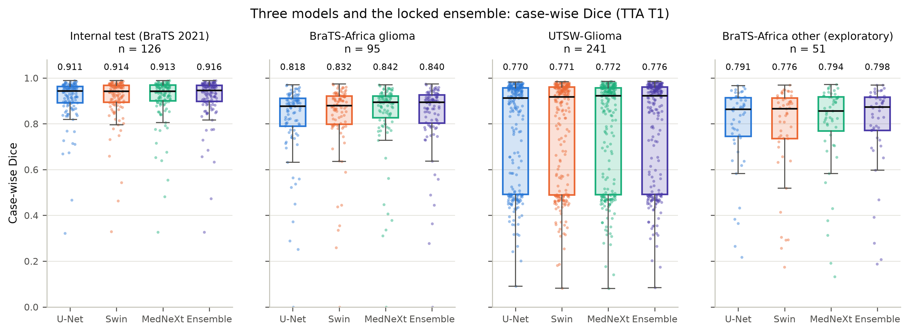
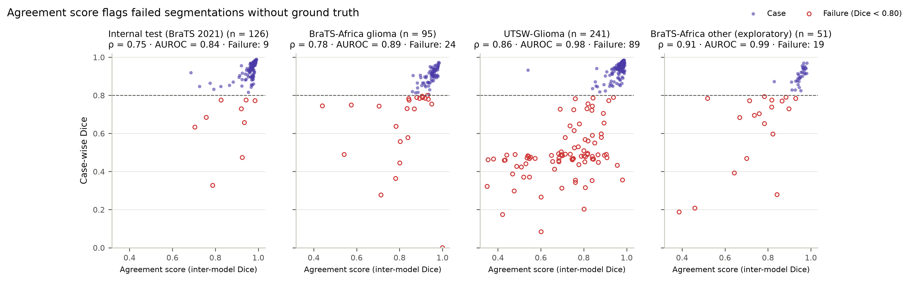
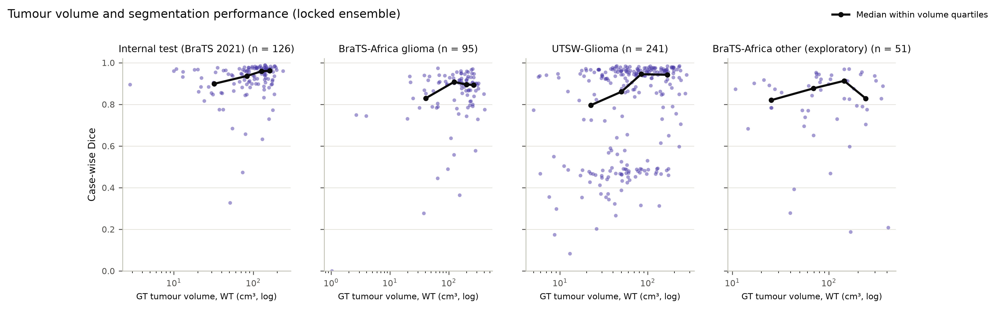
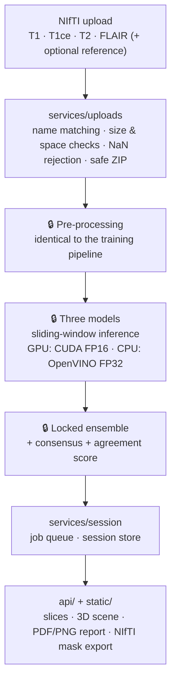
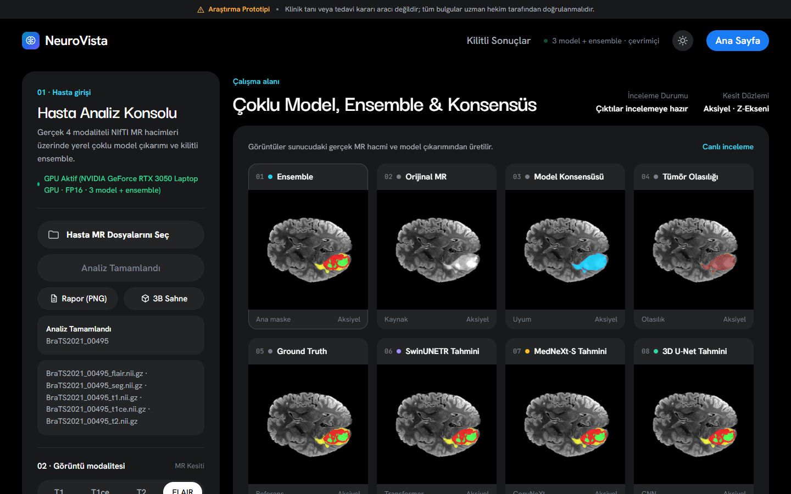
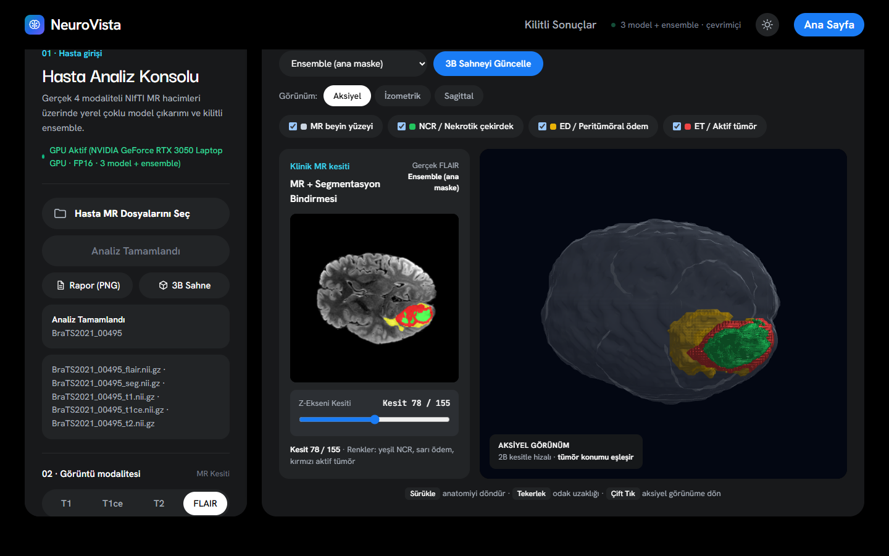

# NeuroVista — Three-Paradigm Brain Tumor Segmentation with Reference-Free Quality Control

[Türkçe](README.md) · **English**

NeuroVista segments glioma sub-regions — necrotic core (**NCR**), peritumoral edema (**ED**) and enhancing tumor (**ET**) — in 3D from multi-modal brain MRI (**T1, T1ce, T2, FLAIR**). It trains three deep learning architectures from three different design paradigms under **one identical protocol**, combines them with an ensemble that was **locked on validation data before the test set was ever touched**, and uses the **agreement between the models** to flag likely failures **without any ground-truth mask**.

> [!NOTE]
> **This is a showcase repository.** It presents the architecture, engineering and results of a private research project. The scientific core (pre-processing, model architectures and ensemble logic), the training pipeline and the trained weights are **not included**, so the code here is meant to be read, not run. See [What is in this repository](#what-is-in-this-repository).

> [!IMPORTANT]
> Research prototype. Not a medical device and not for clinical diagnosis or treatment decisions. See [Disclaimer](#disclaimer).

---

## Contents

- [The problem](#the-problem)
- [Approach](#approach)
- [Results](#results)
- [System architecture](#system-architecture)
- [What is in this repository](#what-is-in-this-repository)
- [Engineering practices](#engineering-practices)
- [Datasets and references](#datasets-and-references)
- [Author](#author)
- [License](#license)
- [Disclaimer](#disclaimer)

---

## The problem

Glioma segmentation drives radiotherapy planning, surgical margins and volumetric follow-up, but manual 3D contouring of 240×240×155-voxel, four-channel volumes is slow and varies between experts. Three gaps motivated this project:

1. **Unfair architecture comparisons.** CNNs and Vision Transformers are often compared with different training budgets, augmentation pipelines or pre-processing. It then becomes unclear whether a difference comes from the architecture or from the recipe.
2. **Silent failures.** On data from other institutions a model can fail without warning. At inference time there is no expert mask, so a calibrated, reference-free quality signal is needed.
3. **Training–serving skew.** Models trained in notebooks must run on local workstations — with a GPU or CPU-only — with exactly the same pre-processing and acceptable latency.

## Approach

| Code | Model | Paradigm | Building block | Parameters |
|:---:|---|---|---|:---:|
| M1 | **Residual 3D U-Net** | Classical local convolution (CNN) | Residual units, 3×3×3 convolutions | ~4.8 M |
| M2 | **SwinUNETR** | Hierarchical self-attention (Vision Transformer) | 3D shifted-window self-attention encoder + CNN decoder | ~15.7 M |
| M3 | **MedNeXt-S (k=3)** | Modern convolution (ConvNeXt design) | Transformer design principles without attention: depthwise convolution, inverted-bottleneck MLP | ~5.6 M |

The third model was chosen by a documented, measured comparison of four candidates rather than by leaderboard score: [docs/UCUNCU_MODEL_SECIMI.md](docs/UCUNCU_MODEL_SECIMI.md) (in Turkish).

- **Same protocol for all three.** All models were trained from scratch on Kaggle (2× NVIDIA T4) with the same data pipeline, loss, patch size and epoch budget. Model-specific tricks that would favour only one architecture were deliberately left out.
- **Pre-registered evaluation.** The evaluation plan was written and locked before the third model was trained and before any test result existed. Every later change went into a dated deviation log. Checkpoint selection, test-time augmentation, the ensemble method and post-processing were all chosen **on validation only**, sealed in a lock file with SHA-256 hashes, and the **test set was used exactly once**. Method: [docs/DEGERLENDIRME_YONTEMI.md](docs/DEGERLENDIRME_YONTEMI.md) (in Turkish).
- **Reference-free quality control.** The *agreement score* is the mean pairwise Dice between the three models' WT, TC and ET masks. It needs no ground truth, so it can be computed in deployment as a warning signal.
- **External validation.** The locked system was then tested once, with nothing re-tuned, on two independent institutions (Nigeria and the United States).

**Regions:** WT = NCR ∪ ED ∪ ET · TC = NCR ∪ ET · ET = ET.

## Results

All numbers below are generated from archived machine records in the private repository and checked by tests there; none are typed by hand.

### Locked internal test (BraTS 2021, 126 cases)

| Model | WT | TC | ET | Patient-level mean [95% CI] | HD95 WT / TC / ET (mm) |
|---|:---:|:---:|:---:|:---:|:---:|
| **Ensemble (primary)** | **0.9415** | **0.9170** | **0.8908** | **0.9161** [0.899–0.931] | 3.91 / 3.23 / 2.74 |
| SwinUNETR | 0.9397 | 0.9141 | 0.8890 | 0.9140 [0.896–0.929] | 3.80 / 3.23 / 2.64 |
| MedNeXt-S | 0.9372 | 0.9121 | 0.8896 | 0.9125 [0.894–0.928] | 4.32 / 3.28 / 2.78 |
| 3D U-Net | 0.9386 | 0.9119 | 0.8820 | 0.9105 [0.894–0.925] | 3.99 / 4.03 / 2.84 |

*ET mean over cases whose reference contains ET. Agreement score vs. Dice: Spearman ρ = 0.754; failed cases (Dice < 0.80): 9, AUROC 0.843.*

### Effect of the protocol (v1 → v2, same unified evaluation)

| Comparison | Difference [95% CI] | Wilcoxon p (Holm) |
|---|:---:|:---:|
| 3D U-Net: v2 − v1 | +0.0114 [+0.0086, +0.0144] | 4.5e-15 |
| SwinUNETR: v2 − v1 | +0.0096 [+0.0055, +0.0143] | 4.7e-11 |
| v2 ensemble − v1 SwinUNETR | +0.0137 [+0.0088, +0.0189] | 8.8e-15 |
| v2 ensemble − v1 3D U-Net | +0.0217 [+0.0180, +0.0261] | 1.3e-20 |

### External validation (locked settings, single run)

| Cohort | Analysis | n | Ensemble patient-level [95% CI] | WT | TC | ET | Best single model | Δ vs. internal test | Agreement AUROC |
|---|---|:---:|:---:|:---:|:---:|:---:|:---:|:---:|:---:|
| BraTS-Africa glioma (Nigeria) | primary | 95 | 0.8402 [0.808–0.869] | 0.9192 | 0.8039 | 0.7976 | MedNeXt-S 0.8422 | −0.076 | 0.888 |
| UTSW-Glioma (USA), expert-corrected masks | primary | 241 | 0.7756 [0.746–0.805] | 0.9216 | 0.6448 | 0.8656 | MedNeXt-S 0.7725 | −0.141 | 0.978 |
| BraTS-Africa, non-glioma tumors | exploratory | 51 | 0.7984 [0.744–0.846] | 0.8534 | 0.7675 | 0.7860 | MedNeXt-S 0.7938 | −0.118 | 0.985 |

*UTSW labels non-enhancing tumor as edema, whereas BraTS counts it as tumor core; this taxonomy difference directly lowers TC. Excluding the 36 cases whose reference has no TC raises the patient-level mean to 0.835 (post-hoc, not pre-registered). UTSW cases with undocumented label codes were reported separately in a WT-only sensitivity analysis (121 cases, ensemble WT 0.8706 [0.852–0.887]).*

### Inference speed and OpenVINO parity (one full volume)

| Model | GPU (web, FP16) | CPU PyTorch FP32 | CPU OpenVINO FP32 | OpenVINO speed-up | Label agreement (OpenVINO) |
|---|:---:|:---:|:---:|:---:|:---:|
| 3D U-Net | 0.7 s | 2.9 s | 1.2 s | 2.42× | 1.0000000 |
| SwinUNETR | 2.0 s | 80.0 s | 19.0 s | 4.22× | 0.9999997 |
| MedNeXt-S | 2.2 s | 72.3 s | 46.4 s | 1.56× | 1.0000000 |

*GPU: NVIDIA GeForce RTX 3050 Laptop (4 GB), web speed mode; end-to-end 6.5 s. Web CPU mode end-to-end 87.6 s. Locked test and external results were produced with PyTorch FP32.*

**Key findings**

1. The locked three-model ensemble reached a patient-level mean Dice of **0.9161** on the internal test and outperformed every single model in paired tests.
2. Re-training the same architectures under the controlled, equal-budget protocol gained about 1 Dice point over the earlier version (p < 10⁻¹⁰).
3. Without seeing any ground truth, the agreement score detected poor segmentations with **AUROC 0.843** internally and **0.888–0.985** on external cohorts.
4. The external drop is explained by concrete causes — lower field strength (1.5 T in BraTS-Africa) and different institutional labelling conventions (UTSW) — rather than by an unexplained collapse.

## System architecture

- **Single source of truth.** The web service and the desktop app contain no pre-processing or ensemble code of their own; both call the same core. A case gives the same mask in both interfaces.
- **Training–serving parity.** Pre-processing and the label decision are defined in one place and shared with the training pipeline; parity is guarded by tests in the private repository.
- **Integrity on start-up.** The service only loads the current model set if the SHA-256 hashes of the weights and of the ensemble lock match the record.
- **Hardware paths.** CUDA FP16 on GPU; on CPU, models whose ONNX export passed the parity check run on OpenVINO FP32, the rest on PyTorch.

Details: [docs/ARCHITECTURE.md](docs/ARCHITECTURE.md) · REST API: [docs/API_ENDPOINTS.md](docs/API_ENDPOINTS.md) (in Turkish).

**Interfaces:** a FastAPI web workstation (landing page, analysis workspace with eight synchronized panels, WebGL2 3D scene, report and mask export) and a CustomTkinter + PyVista desktop application. The interface language is Turkish.

**Analysis workspace:** after the four modalities are uploaded, the ensemble mask, the original MRI, model consensus, tumor probability, the reference mask and each model's prediction are shown side by side on the same slice (example: public BraTS 2021 case `BraTS2021_00495`, GPU web mode).

**3D scene:** the brain surface and the NCR / ED / ET layers are rendered in the browser with WebGL2; the selected slice matches the 2D view.

## What is in this repository

| Included | Not included (private) |
|---|---|
| Web service: `main.py`, `api/`, `services/`, `visualization.py` | 🔒 Scientific core: pre-processing, architectures, ensemble, metrics |
| Web interface: `static/` (HTML, CSS, JavaScript, WebGL2 scene) | 🔒 Training and evaluation pipeline, notebooks, data split |
| Core-independent tests and their CI | 🔒 Trained weights, ensemble lock and weight registry |
| `docker/Dockerfile.web`, `requirements.txt` | 🔒 Desktop application, OpenVINO export, external-validation pipeline |
| Architecture, API, model-selection and evaluation-method documents | 🔒 Raw logs, per-patient records, manuscript and technical report |
| Result figures | MRI data (never redistributed) |

**How this repository stays in sync.** Nothing here is copied by hand. A script in the private repository builds this showcase from an explicit per-file allowlist, reads files from a commit (so untracked files such as weights or `.env` files cannot leak), blocks a deny-list of core paths, and scans every file for secrets and project-specific core terms; any hit stops the export and nothing is written. It runs automatically when the private `main` branch passes CI. [PROVENANCE.md](PROVENANCE.md) lists the source commit and a SHA-256 for every file.

## Engineering practices

- **Pre-registration and locks:** evaluation plan before results; selections sealed with SHA-256; single-use test set; dated deviation log; post-hoc analyses labelled as such.
- **Statistics:** paired Wilcoxon signed-rank tests with Holm correction; bootstrap 95% confidence intervals (10 000 resamples).
- **Testing and CI:** in the private repository, unit, integration, web end-to-end and real-browser (Playwright) tests plus a Docker image build and container smoke test on every push; this repository runs lint and the core-independent tests.
- **Security of the web service:** optional constant-time access token (HttpOnly, SameSite=Strict cookie or Bearer header); limits on upload size, unpacked ZIP size and member count, and volume size; temporary files deleted after every analysis; no internal paths or stack traces in client errors; a single analysis at a time with bounded history and session memory.
- **Reproducibility:** every number in documents and pages comes from one generated results file; figures are generated from per-patient records.

## Datasets and references

**Datasets**

1. **BraTS 2021** — Baid, U., et al. (2021). *The RSNA-ASNR-MICCAI BraTS 2021 Benchmark on Brain Tumor Segmentation and Radiogenomic Classification.* [arXiv:2107.02314](https://arxiv.org/abs/2107.02314). · Menze, B. H., et al. (2015). *The Multimodal Brain Tumor Image Segmentation Benchmark (BRATS).* IEEE TMI 34(10). · Bakas, S., et al. (2017). *Advancing The Cancer Genome Atlas glioma MRI collections with expert segmentation labels and radiomic features.* Scientific Data 4, 170117.
2. **BraTS-Africa** — Adewole, M., et al. (2023). *The BraTS Challenge 2023: Glioma Segmentation in Sub-Saharan Africa Patient Population (BraTS-Africa).* [arXiv:2305.19369](https://arxiv.org/abs/2305.19369). TCIA, doi:[10.7937/v8h6-8x67](https://doi.org/10.7937/v8h6-8x67).
3. **UTSW-Glioma** — Reddy, D., et al. (2026). *UTSW-Glioma (Version 1)* [Data set]. The Cancer Imaging Archive, doi:[10.7937/DFAE-1B86](https://doi.org/10.7937/DFAE-1B86).

External cohorts were run from publicly available copies of these collections on Kaggle. No imaging data is included in this repository.

**Methods and software**

- Ronneberger, O., et al. (2015). *U-Net.* MICCAI · Kerfoot, E., et al. (2018). *Left-Ventricle Quantification Using Residual U-Net.* STACOM.
- Hatamizadeh, A., et al. (2022). *Swin UNETR.* BrainLes 2021. [arXiv:2201.01266](https://arxiv.org/abs/2201.01266).
- Roy, S., et al. (2023). *MedNeXt.* MICCAI. [arXiv:2303.09975](https://arxiv.org/abs/2303.09975).
- Isensee, F., et al. (2021). *nnU-Net.* Nature Methods 18 · Isensee, F., et al. (2024). *nnU-Net Revisited.* MICCAI. [arXiv:2404.09556](https://arxiv.org/abs/2404.09556).
- Cardoso, M. J., et al. (2022). *MONAI.* [arXiv:2211.02701](https://arxiv.org/abs/2211.02701) · Intel *OpenVINO™ Toolkit* · PyTorch · FastAPI.

## Author

**Halit Kılıç** — Department of Computer Engineering, Selçuk University · Academic advisor: Assoc. Prof. Dr. Onur İnan, Selçuk University.

For questions or access requests, please contact me through my GitHub profile.

## License

Copyright © 2026 Halit Kılıç. **All rights reserved.** This repository is published for viewing and evaluation only. No permission is granted to use, copy, modify or distribute any part of it without prior written permission. See [LICENSE](LICENSE). Third-party datasets, papers and libraries cited above remain under their own licenses.

## Disclaimer

NeuroVista is a prototype developed solely for academic research and software-engineering validation. It is not a medical device (not CE or FDA approved). Its segmentation masks, sub-region volumes, probability maps, 3D models and agreement scores must not be used to diagnose, plan radiotherapy or make surgical decisions; all outputs require independent review by qualified medical professionals.
