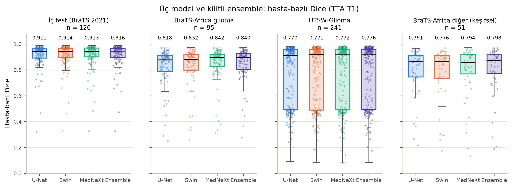
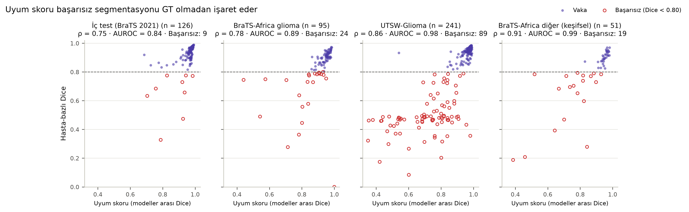
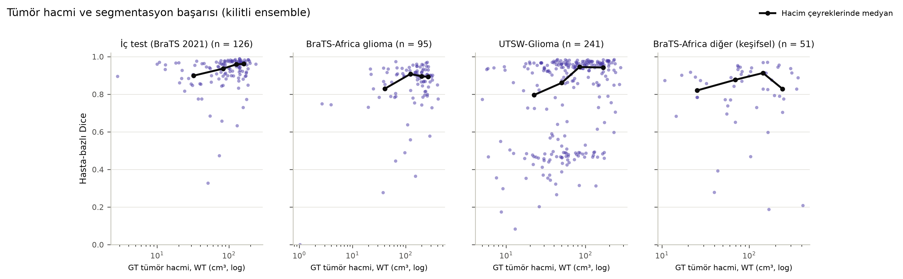
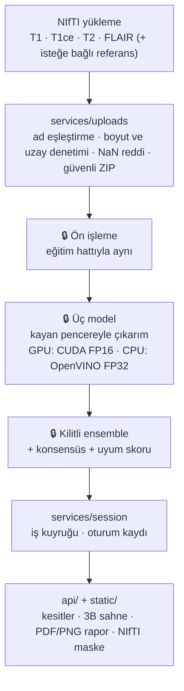

# NeuroVista — Üç Paradigmalı Beyin Tümörü Segmentasyonu ve Referanssız Kalite Kontrolü

[English](README.md) · **Türkçe**

NeuroVista, çok modlu beyin MR'ından (**T1, T1ce, T2, FLAIR**) glioma alt bölgelerini — nekrotik çekirdek (**NCR**), peritümöral ödem (**ED**) ve kontrast tutan tümör (**ET**) — üç boyutlu olarak ayrıştırır. Üç farklı tasarım paradigmasından üç derin öğrenme modelini **birebir aynı protokolle** eğitir, bunları **test kümesine hiç dokunulmadan validation'da kilitlenmiş** bir ensemble ile birleştirir ve **modeller arası uyumu** kullanarak olası başarısız çıkarımları **referans maske olmadan** işaretler.

> [!NOTE]
> **Bu bir vitrin deposudur.** Private bir araştırma projesinin mimarisini, mühendisliğini ve sonuçlarını gösterir. Bilimsel çekirdek (ön işleme, model mimarileri, ensemble mantığı), eğitim hattı ve eğitilmiş ağırlıklar **bu depoda yoktur**; buradaki kod okunmak içindir, çalıştırılmak için değil. Bkz. [Bu depoda neler var](#bu-depoda-neler-var).

> [!IMPORTANT]
> Araştırma prototipidir. Tıbbi cihaz değildir; klinik tanı veya tedavi kararında kullanılamaz. Bkz. [Sorumluluk reddi](#sorumluluk-reddi).

---

## İçindekiler

- [Problem](#problem)
- [Yaklaşım](#yaklaşım)
- [Sonuçlar](#sonuçlar)
- [Sistem mimarisi](#sistem-mimarisi)
- [Bu depoda neler var](#bu-depoda-neler-var)
- [Mühendislik uygulamaları](#mühendislik-uygulamaları)
- [Veri setleri ve kaynaklar](#veri-setleri-ve-kaynaklar)
- [Geliştirici](#geliştirici)
- [Lisans](#lisans)
- [Sorumluluk reddi](#sorumluluk-reddi)

---

## Problem

Glioma segmentasyonu radyoterapi planlamasının, cerrahi sınırların ve hacimsel takibin temelidir. Ancak 240×240×155 voksellik, dört kanallı hacimlerde elle 3B konturlama yavaştır ve uzmanlar arasında değişkendir. Projeyi üç boşluk yönlendirdi:

1. **Adil olmayan mimari karşılaştırmaları.** CNN'ler ve Vision Transformer'lar çoğu zaman farklı eğitim bütçeleri, veri artırma hatları ya da ön işlemelerle karşılaştırılır. Bu durumda farkın mimariden mi, reçeteden mi geldiği belirsizleşir.
2. **Sessiz hatalar.** Başka kurumların verisinde model uyarı vermeden başarısız olabilir. Çıkarım anında uzman maskesi yoktur; referans gerektirmeyen, kalibre bir kalite sinyaline ihtiyaç vardır.
3. **Eğitim–çıkarım uyumsuzluğu.** Notebook'larda eğitilen modeller yerel iş istasyonlarında — GPU'lu ya da yalnız CPU'lu — birebir aynı ön işlemeyle ve kabul edilebilir sürede çalışmalıdır.

## Yaklaşım

| Kod | Model | Paradigma | Yapı taşı | Parametre |
|:---:|---|---|---|:---:|
| M1 | **Residual 3D U-Net** | Klasik yerel evrişim (CNN) | Residual birimler, 3×3×3 evrişim | ~4.8 M |
| M2 | **SwinUNETR** | Hiyerarşik öz-dikkat (Vision Transformer) | 3B kaydırılmış pencereli öz-dikkat kodlayıcı + CNN çözücü | ~15.7 M |
| M3 | **MedNeXt-S (k=3)** | Modern evrişim (ConvNeXt tasarımı) | Dikkat olmadan Transformer tasarım ilkeleri: derinlemesine evrişim, ters darboğaz MLP | ~5.6 M |

Üçüncü model, liderlik tablosu skoruna göre değil; dört adayın belgelenmiş ve ölçülmüş karşılaştırmasıyla seçildi: [docs/UCUNCU_MODEL_SECIMI.md](docs/UCUNCU_MODEL_SECIMI.md).

- **Üçüne aynı protokol.** Bütün modeller Kaggle'da (2× NVIDIA T4) sıfırdan; aynı veri akışı, aynı kayıp, aynı yama boyutu ve aynı epoch bütçesiyle eğitildi. Yalnız bir mimariye fayda sağlayacak özel ayarlar bilerek alınmadı.
- **Ön-kayıtlı değerlendirme.** Değerlendirme planı, üçüncü model eğitilmeden ve hiçbir test sonucu yokken yazılıp kilitlendi. Sonraki her değişiklik tarihli bir sapma kaydına yazıldı. Checkpoint seçimi, test zamanı veri artırma, ensemble yöntemi ve son işlem **yalnız validation'da** seçildi, SHA-256 ile bir kilit dosyasına mühürlendi ve **test kümesi tek bir kez** kullanıldı. Yöntem: [docs/DEGERLENDIRME_YONTEMI.md](docs/DEGERLENDIRME_YONTEMI.md).
- **Referanssız kalite kontrolü.** *Uyum skoru*, üç modelin WT, TC ve ET maskeleri arasındaki ikili Dice'ların ortalamasıdır. Referans gerektirmez; bu yüzden kullanım sırasında uyarı sinyali olarak hesaplanabilir.
- **Harici doğrulama.** Kilitli sistem, hiçbir ayar yeniden seçilmeden, iki bağımsız kurumun (Nijerya ve ABD) verisinde tek seferde sınandı.

**Bölgeler:** WT = NCR ∪ ED ∪ ET · TC = NCR ∪ ET · ET = ET.

## Sonuçlar

Aşağıdaki bütün sayılar private depodaki arşivlenmiş makine kayıtlarından üretilir ve orada testlerle denetlenir; hiçbiri elle yazılmaz.

### Kilitli iç test (BraTS 2021, 126 vaka)

| Model | WT | TC | ET | Hasta-bazlı ort. [%95 GA] | HD95 WT / TC / ET (mm) |
|---|:---:|:---:|:---:|:---:|:---:|
| **Ensemble (birincil)** | **0.9415** | **0.9170** | **0.8908** | **0.9161** [0.899–0.931] | 3.91 / 3.23 / 2.74 |
| SwinUNETR | 0.9397 | 0.9141 | 0.8890 | 0.9140 [0.896–0.929] | 3.80 / 3.23 / 2.64 |
| MedNeXt-S | 0.9372 | 0.9121 | 0.8896 | 0.9125 [0.894–0.928] | 4.32 / 3.28 / 2.78 |
| 3D U-Net | 0.9386 | 0.9119 | 0.8820 | 0.9105 [0.894–0.925] | 3.99 / 4.03 / 2.84 |

*ET ortalaması, referansında ET bulunan vakalar üzerinden. Uyum skoru–Dice: Spearman ρ = 0.754; başarısız vaka (Dice < 0.80): 9, AUROC 0.843.*

### Protokolün etkisi (v1 → v2, aynı birleşik değerlendirme)

| Karşılaştırma | Fark [%95 GA] | Wilcoxon p (Holm) |
|---|:---:|:---:|
| 3D U-Net: v2 − v1 | +0.0114 [+0.0086, +0.0144] | 4.5e-15 |
| SwinUNETR: v2 − v1 | +0.0096 [+0.0055, +0.0143] | 4.7e-11 |
| v2 ensemble − v1 SwinUNETR | +0.0137 [+0.0088, +0.0189] | 8.8e-15 |
| v2 ensemble − v1 3D U-Net | +0.0217 [+0.0180, +0.0261] | 1.3e-20 |

### Harici doğrulama (kilitli ayarlar, tek koşu)

| Kohort | Analiz | n | Ensemble hasta-bazlı [%95 GA] | WT | TC | ET | En iyi tekil model | İç testten fark | Uyum AUROC |
|---|---|:---:|:---:|:---:|:---:|:---:|:---:|:---:|:---:|
| BraTS-Africa glioma (Nijerya) | birincil | 95 | 0.8402 [0.808–0.869] | 0.9192 | 0.8039 | 0.7976 | MedNeXt-S 0.8422 | −0.076 | 0.888 |
| UTSW-Glioma (ABD), uzman düzeltmeli maskeler | birincil | 241 | 0.7756 [0.746–0.805] | 0.9216 | 0.6448 | 0.8656 | MedNeXt-S 0.7725 | −0.141 | 0.978 |
| BraTS-Africa, glioma dışı tümörler | keşifsel | 51 | 0.7984 [0.744–0.846] | 0.8534 | 0.7675 | 0.7860 | MedNeXt-S 0.7938 | −0.118 | 0.985 |

*UTSW kontrast tutmayan tümörü ödem olarak etiketler, BraTS ise tümör çekirdeğine sayar; bu taksonomi farkı TC'yi doğrudan düşürür. Referansında TC olmayan 36 vaka çıkarıldığında hasta-bazlı ortalama 0.835 olur (post-hoc, ön-kayıtlı değil). Belgelenmemiş etiket kodu içeren UTSW vakaları ayrı bir yalnız-WT duyarlılık analizinde raporlandı (121 vaka, ensemble WT 0.8706 [0.852–0.887]).*

### Çıkarım hızı ve OpenVINO paritesi (tek tam hacim)

| Model | GPU (web, FP16) | CPU PyTorch FP32 | CPU OpenVINO FP32 | OpenVINO hızlanması | Etiket uyumu (OpenVINO) |
|---|:---:|:---:|:---:|:---:|:---:|
| 3D U-Net | 0.7 sn | 2.9 sn | 1.2 sn | 2.42× | 1.0000000 |
| SwinUNETR | 2.0 sn | 80.0 sn | 19.0 sn | 4.22× | 0.9999997 |
| MedNeXt-S | 2.2 sn | 72.3 sn | 46.4 sn | 1.56× | 1.0000000 |

*GPU: NVIDIA GeForce RTX 3050 Laptop (4 GB), web hız modu; uçtan uca 6.5 sn. Web CPU modunda uçtan uca 87.6 sn. Kilitli test ve harici sonuçlar PyTorch FP32 ile üretildi.*

**Temel bulgular**

1. Kilitli üçlü ensemble iç testte hasta-bazlı **0.9161** ortalama Dice'a ulaştı ve eşleştirilmiş testlerde her tekil modeli geride bıraktı.
2. Aynı mimarilerin kontrollü, eşit bütçeli protokolle yeniden eğitilmesi önceki sürüme göre yaklaşık 1 Dice puanı kazandırdı (p < 10⁻¹⁰).
3. Uyum skoru, hiçbir referans görmeden düşük başarılı segmentasyonları iç testte **AUROC 0.843**, harici kohortlarda **0.888–0.985** ile yakaladı.
4. Harici düşüş açıklanamayan bir çöküşle değil, somut nedenlerle açıklanıyor: düşük saha gücü (BraTS-Africa'da 1.5 T) ve kurumların farklı etiketleme kuralları (UTSW).

## Sistem mimarisi

- **Tek doğruluk kaynağı.** Web servisi ve masaüstü uygulaması kendi ön işleme ya da ensemble kodunu taşımaz; ikisi de aynı çekirdeği çağırır. Bir vaka iki arayüzde de aynı maskeyi verir.
- **Eğitim–çıkarım paritesi.** Ön işleme ve etiket kararı tek yerde tanımlıdır ve eğitim hattıyla paylaşılır; parite private depoda testlerle korunur.
- **Açılışta bütünlük.** Servis, ağırlıkların ve ensemble kilidinin SHA-256 özetleri kayıtla eşleşmezse güncel model setini yüklemez.
- **Donanım yolları.** GPU'da CUDA FP16; CPU'da ONNX paritesi doğrulanmış modeller OpenVINO FP32 ile, diğerleri PyTorch ile.

Ayrıntı: [docs/ARCHITECTURE.md](docs/ARCHITECTURE.md) · REST API: [docs/API_ENDPOINTS.md](docs/API_ENDPOINTS.md).

**Arayüzler:** FastAPI web iş istasyonu (tanıtım sayfası, sekiz eşzamanlı panelli analiz alanı, WebGL2 3B sahne, rapor ve maske dışa aktarımı) ve CustomTkinter + PyVista masaüstü uygulaması.

## Bu depoda neler var

| Var | Yok (private) |
|---|---|
| Web servisi: `main.py`, `api/`, `services/`, `visualization.py` | 🔒 Bilimsel çekirdek: ön işleme, mimariler, ensemble, metrikler |
| Web arayüzü: `static/` (HTML, CSS, JavaScript, WebGL2 sahnesi) | 🔒 Eğitim ve değerlendirme hattı, notebook'lar, veri bölünümü |
| Çekirdekten bağımsız testler ve CI'ı | 🔒 Eğitilmiş ağırlıklar, ensemble kilidi ve ağırlık kaydı |
| `docker/Dockerfile.web`, `requirements.txt` | 🔒 Masaüstü uygulaması, OpenVINO dışa aktarımı, harici doğrulama hattı |
| Mimari, API, model seçimi ve değerlendirme yöntemi belgeleri | 🔒 Ham günlükler, hasta bazlı kayıtlar, makale ve teknik rapor |
| Sonuç şekilleri | MR verisi (hiçbir zaman yeniden dağıtılmaz) |

**Bu depo nasıl güncel kalıyor?** Buradaki hiçbir dosya elle kopyalanmaz. Private depodaki bir betik bu vitrini dosya dosya yazılmış bir izin listesinden üretir. Dosyaları bir commit'ten okur; bu yüzden git'e girmemiş ağırlık ya da `.env` gibi dosyalar sızamaz. Çekirdek yollarını yasak listeyle engeller ve her dosyayı gizli bilgi ile projeye özgü kalp ifadeleri için tarar. Herhangi bir bulguda dışa aktarım durur ve hiçbir dosya yazılmaz. Private `main` dalı CI'dan geçince bu süreç kendiliğinden çalışır. [PROVENANCE.md](PROVENANCE.md), kaynak commit'i ve her dosyanın SHA-256 özetini listeler.

## Mühendislik uygulamaları

- **Ön-kayıt ve kilitler:** plan sonuçtan önce; seçimler SHA-256 ile mühürlü; tek kullanımlık test kümesi; tarihli sapma kaydı; post-hoc analizler açıkça etiketli.
- **İstatistik:** Holm düzeltmeli eşleştirilmiş Wilcoxon işaretli sıra testleri; bootstrap %95 güven aralıkları (10 000 yeniden örnekleme).
- **Test ve CI:** private depoda her gönderimde birim, entegrasyon, web uçtan uca ve gerçek tarayıcı (Playwright) testleri ile Docker imajı derleme ve konteyner duman testi; bu depoda kod denetimi ve çekirdekten bağımsız testler.
- **Web servisi güvenliği:** isteğe bağlı, sabit zamanlı karşılaştırmalı erişim belirteci (HttpOnly, SameSite=Strict çerez ya da Bearer başlığı); yükleme boyutu, açılmış ZIP boyutu ve üye sayısı ile hacim boyutu sınırları; her analizden sonra silinen geçici dosyalar; istemci hatalarında iç yol ya da yığın izi yok; aynı anda tek analiz, sınırlı iş geçmişi ve oturum belleği.
- **Yeniden üretilebilirlik:** belgelerdeki ve sayfalardaki her sayı tek bir üretilmiş sonuç dosyasından gelir; şekiller hasta bazlı kayıtlardan üretilir.

## Veri setleri ve kaynaklar

**Veri setleri**

1. **BraTS 2021** — Baid, U., vd. (2021). *The RSNA-ASNR-MICCAI BraTS 2021 Benchmark on Brain Tumor Segmentation and Radiogenomic Classification.* [arXiv:2107.02314](https://arxiv.org/abs/2107.02314). · Menze, B. H., vd. (2015). *The Multimodal Brain Tumor Image Segmentation Benchmark (BRATS).* IEEE TMI 34(10). · Bakas, S., vd. (2017). *Advancing The Cancer Genome Atlas glioma MRI collections with expert segmentation labels and radiomic features.* Scientific Data 4, 170117.
2. **BraTS-Africa** — Adewole, M., vd. (2023). *The BraTS Challenge 2023: Glioma Segmentation in Sub-Saharan Africa Patient Population (BraTS-Africa).* [arXiv:2305.19369](https://arxiv.org/abs/2305.19369). TCIA, doi:[10.7937/v8h6-8x67](https://doi.org/10.7937/v8h6-8x67).
3. **UTSW-Glioma** — Reddy, D., vd. (2026). *UTSW-Glioma (Version 1)* [Veri seti]. The Cancer Imaging Archive, doi:[10.7937/DFAE-1B86](https://doi.org/10.7937/DFAE-1B86).

Harici kohortlar, bu koleksiyonların Kaggle'daki kamuya açık kopyaları üzerinden çalıştırıldı. Bu depoda hiçbir görüntü verisi yoktur.

**Yöntemler ve yazılım**

- Ronneberger, O., vd. (2015). *U-Net.* MICCAI · Kerfoot, E., vd. (2018). *Left-Ventricle Quantification Using Residual U-Net.* STACOM.
- Hatamizadeh, A., vd. (2022). *Swin UNETR.* BrainLes 2021. [arXiv:2201.01266](https://arxiv.org/abs/2201.01266).
- Roy, S., vd. (2023). *MedNeXt.* MICCAI. [arXiv:2303.09975](https://arxiv.org/abs/2303.09975).
- Isensee, F., vd. (2021). *nnU-Net.* Nature Methods 18 · Isensee, F., vd. (2024). *nnU-Net Revisited.* MICCAI. [arXiv:2404.09556](https://arxiv.org/abs/2404.09556).
- Cardoso, M. J., vd. (2022). *MONAI.* [arXiv:2211.02701](https://arxiv.org/abs/2211.02701) · Intel *OpenVINO™ Toolkit* · PyTorch · FastAPI.

## Geliştirici

**Halit Kılıç** — Bilgisayar Mühendisliği Bölümü, Selçuk Üniversitesi · Akademik danışman: Doç. Dr. Onur İnan, Selçuk Üniversitesi.

Sorular ve erişim talepleri için GitHub profilim üzerinden iletişime geçebilirsiniz.

## Lisans

Telif hakkı © 2026 Halit Kılıç. **Tüm hakları saklıdır.** Bu depo yalnız görüntüleme ve değerlendirme amacıyla yayımlanmıştır. Önceden yazılı izin alınmadan herhangi bir bölümünün kullanılması, kopyalanması, değiştirilmesi veya dağıtılması serbest değildir. Bkz. [LICENSE](LICENSE). Yukarıda anılan üçüncü taraf veri setleri, yayınlar ve kütüphaneler kendi lisanslarına tabidir.

## Sorumluluk reddi

NeuroVista yalnız akademik araştırma ve yazılım mühendisliği doğrulaması amacıyla geliştirilmiş bir prototiptir. Tıbbi cihaz değildir (CE veya FDA onayı yoktur). Ürettiği segmentasyon maskeleri, alt bölge hacimleri, olasılık haritaları, 3B modeller ve uyum skorları tanı koymak, radyoterapi planlamak veya cerrahi karar vermek için kullanılamaz; bütün çıktılar nitelikli tıp uzmanlarının bağımsız değerlendirmesini gerektirir.
